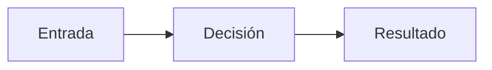

# ADR-NNN: [Decisión única: problema y solución]

> Un ADR registra una sola decisión. Si aparece otra decisión, crea un ADR nuevo.

- **Estado**: Propuesto | Aceptado | Rechazado | Obsoleto | Reemplazado
- **Fecha**: YYYY-MM-DD
- **Autores**: [Nombre(s) o equipo]
- **Reemplaza a**: [Opcional: ADR-NNN; elimina la línea si no aplica]

## 1. Contexto y problema

[Describe el contexto, la necesidad de negocio o técnica y la pregunta que la decisión debe responder. Incluye las restricciones relevantes y lo que ocurre si no se toma la decisión.]

## 2. Opciones consideradas

[Registra al menos dos alternativas reales, con nombre propio, no solo etiquetas genéricas.]

1. **[Nombre concreto de la opción 1]**: [descripción breve].
2. **[Nombre concreto de la opción 2]**: [descripción breve].

- **[Opción 1]**: favorable porque [razón]; desfavorable porque [razón].
- **[Opción 2]**: favorable porque [razón]; desfavorable porque [razón].

## 3. Decisión arquitectónica

[Indica la opción elegida y justifícala frente a las demás. Si la decisión afecta la estructura del sistema, incluye un diagrama Mermaid que muestre las piezas y la dirección de las dependencias.]

## 4. Consecuencias y trade-offs

- **Favorables**: [mejoras, capacidades nuevas o riesgos reducidos].
- **Desfavorables**: [costo, complejidad o limitaciones asumidas].
