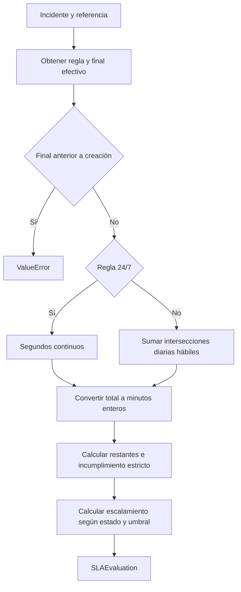

# ADR-002: Cálculo de SLA por intersecciones de horario hábil

- **Estado**: Aceptado
- **Fecha**: 2026-11-17
- **Autor(es)**: Equipo IncidentOps
- **Componentes Afectados**: [`src/sla_calculator.py`]

---

## 1. Contexto y Problema

El evaluador actual contabiliza tiempo continuo para todas las severidades. Esto sobreestima el consumo de SLA de P2/P3 durante noches y fines de semana. P0/P1 requieren cómputo continuo; P2/P3 requieren exclusivamente lunes a viernes de 08:00 a 18:00.

Se conservan la firma pública, los modelos y la tabla SLA: P0=60, P1=240, P2=480 y P3=1440 minutos, con umbral de escalamiento de 0.75. La solución debe ser determinista y utilizar únicamente la biblioteca estándar. Se reciben fechas locales naive coherentes; no se incorporan festivos ni conversiones de zona horaria.

## 2. Opciones Consideradas

1. **Opción A — Recorrido minuto a minuto**:
   - *Ventajas*: La condición de pertenencia al horario resulta sencilla.
   - *Desventajas*: El costo O(M) crece con los minutos del intervalo y exige cuidado adicional con fracciones de minuto.
2. **Opción B — Resta de fines de semana**:
   - *Ventajas*: Reduce el trabajo de recorrido.
   - *Desventajas*: Sin recorte de noches y extremos diarios produce resultados incorrectos para creaciones y cierres fuera del horario.
3. **Opción C — Intersecciones diarias**:
   - *Ventajas*: Recorta exactamente cada ventana hábil y requiere O(D) tiempo y O(1) memoria auxiliar, donde D es el número de fechas del intervalo.
   - *Desventajas*: Recorre también fechas sin aporte y requiere construir los límites diarios.

## 3. Decisión Arquitectónica

Se elige la opción C por su precisión y costo proporcional a días. El final efectivo es `resolved_at` cuando existe; en caso contrario es `reference_time`. Un final anterior a la creación produce `ValueError`.

Para reglas 24/7 se toma la duración completa. Para las demás, cada lunes a viernes aporta la intersección positiva entre el intervalo del incidente y la ventana [08:00, 18:00). Se acumulan segundos de todas las intersecciones y se aplica una sola conversión mediante división entera entre 60, evitando perder fracciones por día.

Los minutos restantes se calculan como permitidos menos transcurridos y pueden ser negativos. El incumplimiento conserva la comparación estricta `elapsed_minutes > allowed_minutes`: alcanzar exactamente el límite no constituye incumplimiento. El escalamiento se activa cuando un incidente no está `RESOLVED` y alcanza `int(allowed_minutes * 0.75)`; permanece activo después del vencimiento. Por tanto, incumplimiento y escalamiento pueden ser verdaderos simultáneamente.

## 4. Consecuencias e Impacto

- **Positivas**: El consumo P2/P3 excluye noches y fines de semana; se conserva la compatibilidad de los consumidores y no se agregan dependencias. El recorrido diario evita el costo del conteo minuto a minuto.
- **Negativas / Trade-offs**: El costo sigue creciendo con los días del intervalo. No se contemplan festivos, horarios personalizados ni cambios de zona horaria. La coherencia de las fechas naive constituye una precondición del llamador. Las fracciones finales de minuto se descartan. Los consumidores deben admitir escalamiento e incumplimiento simultáneos.
- **Verificación**: La auditoría integrada se ejecuta desde la raíz del proyecto mediante `python -m src.sla_calculator`, sin `-O`, para conservar las aserciones. Comprueba minutos, permitidos, restantes y ambas banderas; verifica también `ValueError` para intervalos invertidos. La ejecución y su resultado deben reportarse únicamente después de realizarla.

| Caso | Minutos | Incumple | Escala |
| --- | ---: | --- | --- |
| P2 viernes 06/11/2026 18:30 a lunes 09/11 08:30 | 30 | No | No |
| P2 sábado 07/11 10:00 a lunes 09/11 09:00 | 60 | No | No |
| P2 viernes 06/11 17:00 a lunes 09/11 09:00 | 120 | No | No |
| P0 mismo intervalo | 3840 | Sí | Sí |
| P2 lunes 09/11 08:00 a 14:00 | 360 | No | Sí |
| P2 lunes 09/11 08:00 a 16:00 | 480 | No | Sí |
| P2 lunes 09/11 08:00 a 17:00 | 540 | Sí | Sí |
| P2 viernes 06/11 17:00 a lunes 16/11 09:00 | 3120 | Sí | Sí |
| P2 creado viernes 06/11 17:00, resuelto lunes 09/11 09:00 | 120 | No | No |

La auditoría añade cobertura de P1/P3, cierre después del vencimiento, intervalos vacíos, fin de semana completo y acumulación de segundos entre días.
