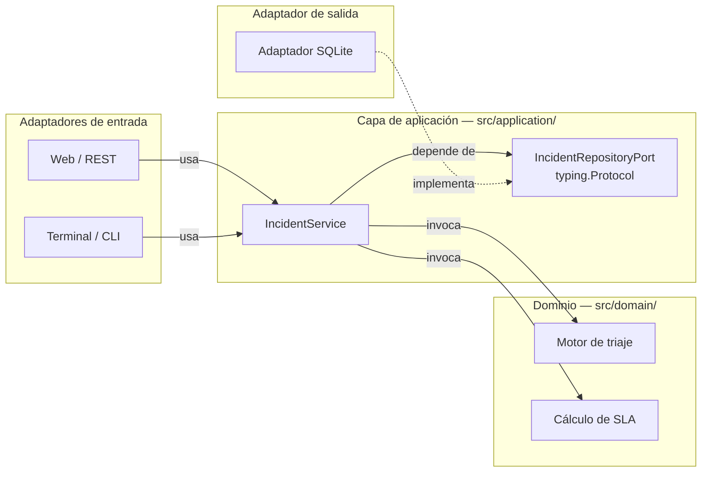

# ADR-003: Arquitectura hexagonal para IncidentOps

- **Estado**: Aceptado
- **Fecha**: 2026-11-21
- **Autores**: Equipo IncidentOps

## 1. Contexto y problema

La hoja de ruta de IncidentOps prevé triaje desde web y terminal sin guardar reportes, resumen de incidentes activos con filtro por componente, registro con alertas de duplicados y evaluación de SLA, y finalmente persistencia dedicada en contenedores. La ubicación prevista del triaje y el SLA es `src/domain/`, como reglas deterministas reutilizables. Hoy no existe una capa de aplicación que coordine los casos de uso ni un contrato estable para la persistencia, por lo que las interfaces podrían duplicar secuencias y acoplarse a SQLite.

¿Cómo organizamos el sistema para que REST y terminal compartan exactamente las mismas decisiones de negocio y para cambiar la persistencia sin reescribir esas decisiones?

## 2. Opciones consideradas

1. **Capas acoplada a FastAPI y SQLite**: los adaptadores web y de terminal llaman directamente a la persistencia y a las reglas; la tecnología de interfaz y de base de datos queda presente en las capas superiores.
2. **Arquitectura hexagonal con un puerto de repositorio**: un servicio de aplicación coordina los casos de uso, invoca directamente el dominio y depende de un único contrato de persistencia; las interfaces y SQLite son adaptadores alrededor del núcleo.

- **Capas acoplada a FastAPI y SQLite**: favorable porque tiene menos piezas y un flujo directo útil para un prototipo; desfavorable porque facilita duplicar reglas entre REST y terminal, acopla los casos de uso al framework y obliga a tocar capas superiores al cambiar la persistencia.
- **Arquitectura hexagonal con un puerto de repositorio**: favorable porque centraliza los casos de uso, mantiene el dominio en `src/domain/` y permite sustituir SQLite sin modificar el servicio; desfavorable porque introduce indirección, un contrato y mapeos que una solución directa no requiere.

## 3. Decisión arquitectónica

Se elige la arquitectura hexagonal. La capa de aplicación en `src/application/` contiene `IncidentService` y `IncidentRepositoryPort`. `IncidentService` será el único punto de entrada de los casos de uso: clasificar y enrutar sin guardar, consultar incidentes activos con incumplimientos de SLA y filtro por componente, registrar incidentes, alertar sobre duplicados abiertos y evaluar el SLA. REST y la terminal son adaptadores de entrada: apuntan a `IncidentService` y no contienen reglas de negocio.

El servicio invoca directamente el motor de triaje y el cálculo de SLA ubicados en `src/domain/`. Para la persistencia depende de `IncidentRepositoryPort`, definido con `typing.Protocol`; el adaptador SQLite implementa ese puerto. Las operaciones que evalúan SLA reciben el instante de referencia como parámetro.

Las flechas sólidas muestran el uso de casos de uso, reglas de dominio y contratos; la punteada muestra la implementación del contrato por parte del adaptador SQLite. La dependencia apunta hacia `IncidentService`, el dominio o el puerto de repositorio, nunca hacia la tecnología concreta.

## 4. Consecuencias y trade-offs

- **Favorables**: una sola coordinación de casos de uso para REST y terminal; reglas de triaje y SLA concentradas en `src/domain/`; posibilidad de cambiar la persistencia implementando un solo puerto; instante de referencia explícito en las operaciones que lo requieren; frameworks y motores de base de datos fuera del núcleo.
- **Desfavorables**: sigue existiendo indirección entre el servicio y la persistencia; hay que definir y mantener estable el `typing.Protocol`; aparecen mapeos entre entradas de interfaz, modelos de dominio y registros SQLite; la curva de incorporación es mayor que en una capa acoplada.
