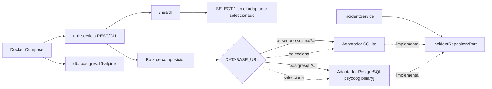

# ADR-004: Persistencia dual SQLite/PostgreSQL y ejecución en contenedores

> Un ADR registra una sola decisión. Si aparece otra decisión, crea un ADR nuevo.

- **Estado**: Aceptado
- **Fecha**: 2026-11-24
- **Autores**: Equipo IncidentOps
- **Reemplaza a**: Parcialmente, la restricción atribuida al ADR-001 de usar solo SQLite embebido (`sqlite3`) sin dependencias externas de base de datos. Verificación: no existe `docs/adr/001-*.md` en el repositorio; el listado de `docs/adr/` contiene `000-template.md`, `002-calculo-sla-horario-habil.md`, `003-arquitectura-hexagonal.md` y este ADR. Por tanto no puede comprobarse el texto original del ADR-001.

## 1. Contexto y problema

IncidentOps persiste hoy en SQLite embebido, con `DATABASE_URL` opcional y base en memoria por defecto para pruebas. El Hito 004 exige ejecutar el servicio con una base de datos relacional dedicada y verificar su conectividad como parte de la puesta en marcha.

La decisión debe conservar el puerto `IncidentRepositoryPort` y la separación de capas del ADR-003, mantener el entorno local determinista y evitar que el dominio o los casos de uso conozcan el motor de persistencia. Si no se decide, la API seguirá ligada a un archivo SQLite local, no podrá comprobar una base dedicada y cada integración podría elegir una estrategia distinta de conexión y de representación de fechas.

## 2. Opciones consideradas

1. **SQLite embebido con volumen persistente**: mantener un único adaptador `sqlite3`, colocar el archivo de base de datos en un volumen del contenedor `api` y no introducir otro motor.
2. **Soporte dual SQLite/PostgreSQL sin ORM**: conservar el adaptador SQLite para desarrollo y pruebas, añadir un adaptador PostgreSQL con `psycopg[binary]`, seleccionar el motor desde `DATABASE_URL` y mantener SQL parametrizado y esquema equivalente en ambos.

- **SQLite embebido con volumen persistente**: favorable porque no añade dependencias de base de datos, preserva las pruebas actuales y reduce la configuración; desfavorable porque la base sigue ligada al archivo y al contenedor de la API, no constituye una base dedicada y comparte contendención sobre un único archivo.
- **Soporte dual SQLite/PostgreSQL sin ORM**: favorable porque permite operar con PostgreSQL en contenedores sin romper las pruebas locales y mantiene el dominio detrás del mismo puerto; desfavorable porque obliga a mantener dos adaptadores, dos esquemas equivalentes y una convención común de serialización temporal.

## 3. Decisión arquitectónica

Se propone la **opción 2**. La raíz de composición seleccionará el adaptador según `DATABASE_URL`: ausente, vacía, `sqlite:///:memory:` o `sqlite:///...` usan SQLite; `postgresql://...` usa PostgreSQL con `psycopg[binary]`. Cualquier otro esquema se rechaza. Ambos adaptadores implementan `IncidentRepositoryPort`, ejecutan SQL parametrizado y no introducen ORM.

Las columnas `created_at` y `resolved_at`, y cualquier otra marca temporal del esquema, se almacenan como ISO 8601 local naive en columnas `TEXT`. Se serializan con `datetime.isoformat()` y se reconstruyen con `datetime.fromisoformat()`. No se usan tipos nativos `TIMESTAMP`, zonas horarias ni conversiones; así el comportamiento observable es el mismo en ambos motores.

Docker Compose define los servicios `api` y `db`. El servicio `db` usa `postgres:16-alpine` con volumen persistente y healthcheck. El servicio `api` espera a que `db` esté saludable, recibe `DATABASE_URL` apuntando a `db` y expone `/health`, que comprueba la conexión del adaptador seleccionado mediante `SELECT 1`.

La dependencia sigue apuntando hacia `IncidentService` y el puerto; el motor concreto queda confinado a los adaptadores de salida.

## 4. Consecuencias y trade-offs

- **Favorables**: se mantiene SQLite para desarrollo y pruebas; la API puede operar contra una base PostgreSQL dedicada en contenedores; el dominio y los casos de uso no cambian; `/health` refleja la conectividad real del motor seleccionado; la ausencia de ORM evita una capa intermedia adicional.
- **Desfavorables**: hay que mantener esquema, índices y comportamiento equivalentes en dos adaptadores; aparece la dependencia `psycopg[binary]`; el uso de `TEXT` para fechas reduce las operaciones nativas de base de datos y exige serialización consistente; Docker Compose añade healthchecks, volumen y configuración operativa.
- **Alcance de la verificación**: este ADR está en estado `Aceptado` y no reporta ejecución de contenedores ni pruebas. La única comprobación documentada es la existencia de los archivos en `docs/adr/`, necesaria para calificar el reemplazo parcial del ADR-001.
